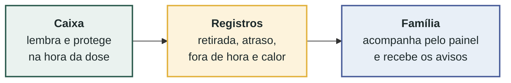

# Memora

**Cuidar de quem cuida.**

Caixa de remédios conectada para idosos com Alzheimer e suas famílias.

Global Solution 2026.2 · CitizenTech · FIAP · Engenharia de Software

---

## O problema

Para quem tem Alzheimer, o remédio traz duas dúvidas todos os dias: *"já está na hora?"* e *"será que eu já tomei?"*. Esquecer a dose atrapalha o tratamento, e tomar duas vezes pode ser perigoso. Enquanto isso, a família, muitas vezes longe, fica sem saber o que aconteceu.

## A solução

O **Memora** troca essa dúvida por informação. Na hora de cada dose, a caixa libera **só o compartimento certo** e toca um lembrete com a voz gravada da família. Um sensor percebe quando o remédio sai da caixa. Se ninguém retira a dose, ou se alguém tenta abrir outro compartimento fora de hora, o cuidador recebe um aviso. A caixa também vigia a temperatura onde os remédios ficam guardados e funciona mesmo sem internet.

O objetivo é simples: que a pessoa idosa tome o remédio certo, na hora certa, com mais autonomia, e que a família só precise agir quando algo realmente sair do lugar.

---

## As partes do projeto

| Repositório | O que é | Tecnologias | Disciplina |
|---|---|---|---|
| [**caixa**](https://github.com/CitizenTech-Memora/caixa) | A caixa de remédios inteligente, simulada no Wokwi: libera o compartimento certo, lembra, confirma a retirada e mede a temperatura | ESP32 · C++ · Wokwi | Edge Computing & Computer Systems |
| [**central-do-cuidador**](https://github.com/CitizenTech-Memora/central-do-cuidador) | Central em terminal para cadastrar remédios, registrar cada retirada e ver o resumo da semana | Python · JSON | Computational Thinking with Python |
| [**modelagem-matematica**](https://github.com/CitizenTech-Memora/modelagem-matematica) | Modelo que mostra como atrasar, esquecer ou dobrar uma dose muda a concentração do remédio no corpo | Python · NumPy · Matplotlib | Differentiated Problem Solving |
| [**painel-web**](https://github.com/CitizenTech-Memora/painel-web) | Painel do Cuidador: status das doses do dia, alertas, rede de cuidado, lembrete de voz e adesão semanal | React · Tailwind CSS · MockAPI | Web Development e Front-end Design |

### As regras que todas as partes seguem

| Regra | Valor |
|---|---|
| Compartimentos | 🟡 manhã · 🟠 tarde · 🔵 noite |
| Lembrete | 10 min depois do horário |
| Dose no horário | Retirada em até 20 min |
| Temperatura máxima | 30 °C (o valor certo depende da bula) |
| Indicador de impacto | **Taxa de adesão:** % de doses retiradas no horário, por semana |

---

## Objetivos de Desenvolvimento Sustentável

- **ODS 3 · Saúde e bem-estar** (principal): apoiar a adesão ao tratamento de pessoas idosas com Alzheimer.
- **ODS 10 · Redução das desigualdades** (secundário): mais autonomia para a pessoa idosa e menos sobrecarga para quem cuida.

> **Importante:** o Memora é um **apoio ao cuidado** e não substitui o cuidador, o médico ou o farmacêutico. O sistema registra a *retirada* do remédio, não confirma que ele foi ingerido. Pessoas, telefones, remédios e horários do projeto são **fictícios**.

---

## Equipe

| Nome | RM |
|------|----|
| Eric Kang | 572575 |
| Guilherme Tomé Nogueira | 570144 |
| Lucas de Andrade Astorini | 569119 |
| Sabrina Lopes da Silva | 571870 |
| Sofia Satomi Hagio | 569120 |
